# Key M Tech Pvt Ltd: Portfolio

RPA, AI agents, LLM apps, test automation and Raspberry Pi / PiKVM remote ops.
Led by an Automation Anywhere certified developer (Agentic Process Automation + Essential Developer) with 13+ years of enterprise delivery.

**Live site:** https://trabl3moon.github.io/keymtech-portfolio/  
**Hire us:** https://www.freelancer.com/u/rahulid6

> These are project write-ups and self-drawn diagrams. Client and proprietary source code is not published.

## AI Incident Command Center
*Agentic Process Automation*

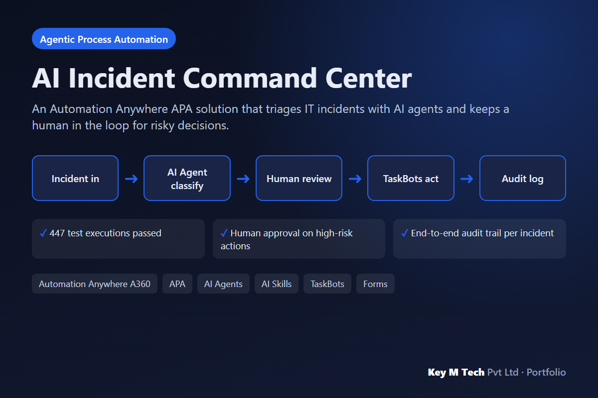

**Problem:** Incident queues were triaged by hand: slow, inconsistent and hard to audit.

**What we built:** A 43-node APA process orchestrates 2 AI Agents, 3 AI Skills and 13 TaskBots. Agents classify and enrich incidents, TaskBots execute approved actions, and human-review forms gate anything high risk. Shared exception paths and correlated audit logs make every run traceable.

- 447 test executions passed
- Human approval on high-risk actions
- End-to-end audit trail per incident

**Stack:** Automation Anywhere A360, APA, AI Agents, AI Skills, TaskBots, Forms

## Multi-Agent Orchestration Framework
*AI Agents*

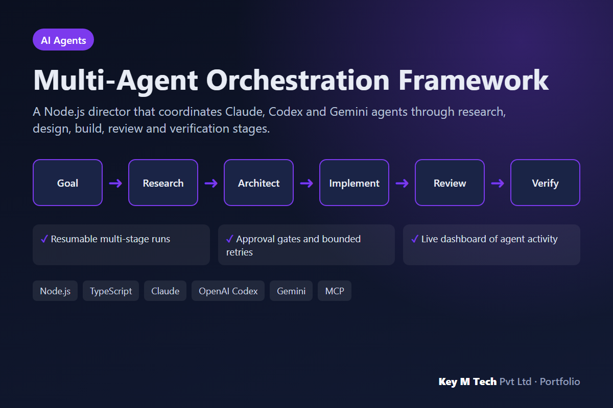

**Problem:** Single-agent coding runs lose context, skip review and are hard to resume.

**What we built:** A central director assigns stages to specialist agents, keeps persistent shared context, asks for approval at gates, retries with limits and emits audit events to a monitoring dashboard. Runs can be paused and resumed.

- Resumable multi-stage runs
- Approval gates and bounded retries
- Live dashboard of agent activity

**Stack:** Node.js, TypeScript, Claude, OpenAI Codex, Gemini, MCP

## ContextCompressor
*LLM Cost Optimisation*

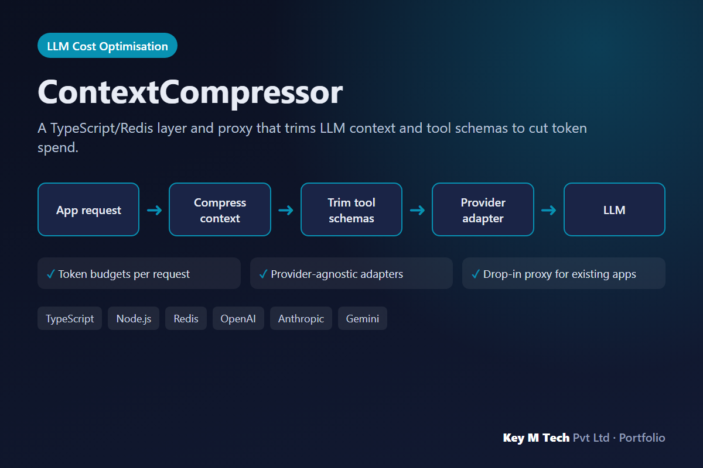

**Problem:** Long agent sessions and large tool schemas made every LLM call expensive and slow.

**What we built:** Compresses conversation history and tool definitions under a token budget, keeps sessions in Redis, and exposes provider adapters for OpenAI, Anthropic and Gemini behind one proxy.

- Token budgets per request
- Provider-agnostic adapters
- Drop-in proxy for existing apps

**Stack:** TypeScript, Node.js, Redis, OpenAI, Anthropic, Gemini

## No-code AI Agent Builder
*AI Platform*

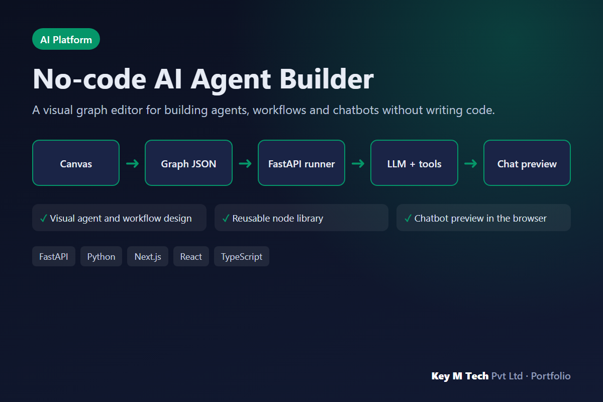

**Problem:** Business teams needed to prototype agents without waiting on developers.

**What we built:** Drag-and-drop nodes (LLM, tool, condition, memory) on a canvas; the FastAPI backend executes the graph and streams results to the Next.js UI.

- Visual agent and workflow design
- Reusable node library
- Chatbot preview in the browser

**Stack:** FastAPI, Python, Next.js, React, TypeScript

## GST Invoice & E-Way Bill App
*Web App*

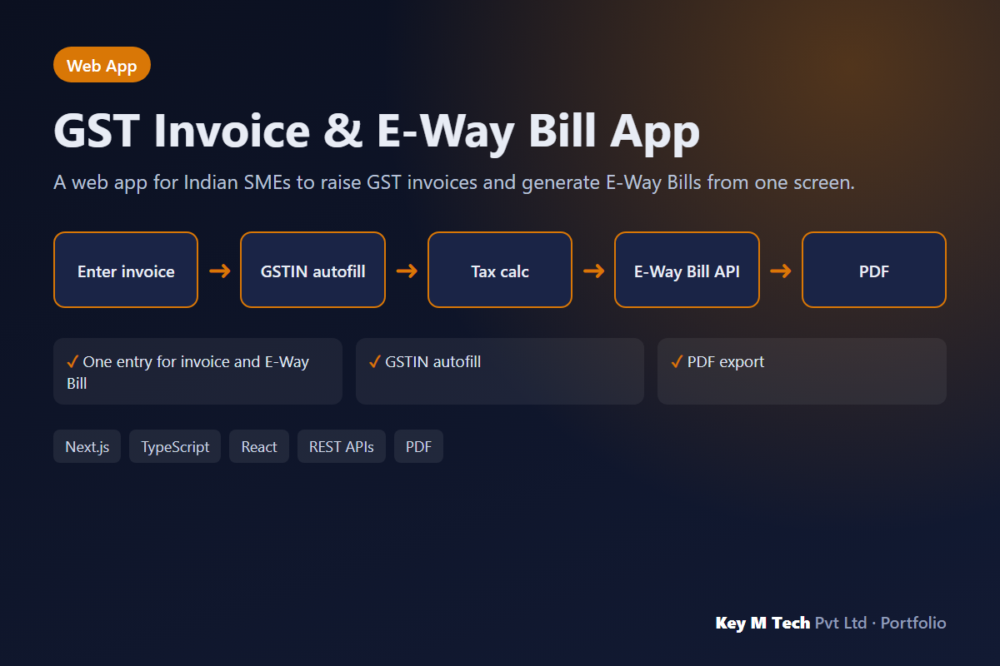

**Problem:** Invoices and E-Way Bills were typed twice, in different systems, with frequent GSTIN errors.

**What we built:** GSTIN lookup autofills party details, invoices compute tax automatically, E-Way Bills are created through the official API, and documents export to PDF.

- One entry for invoice and E-Way Bill
- GSTIN autofill
- PDF export

**Stack:** Next.js, TypeScript, React, REST APIs, PDF

## E-Way Bill RPA Bot
*RPA*

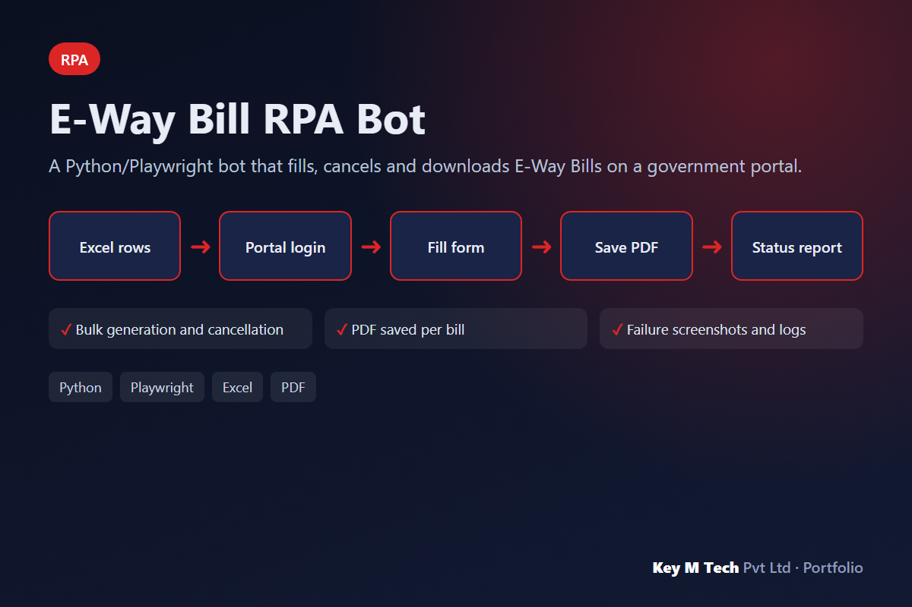

**Problem:** Staff spent hours a day on repetitive portal data entry.

**What we built:** Reads a spreadsheet of shipments, logs in with an operator-entered session, fills each form, saves the PDF, and writes a status report with screenshots on failure.

- Bulk generation and cancellation
- PDF saved per bill
- Failure screenshots and logs

**Stack:** Python, Playwright, Excel, PDF

## AI IT Ticket Triage
*Governed AI*

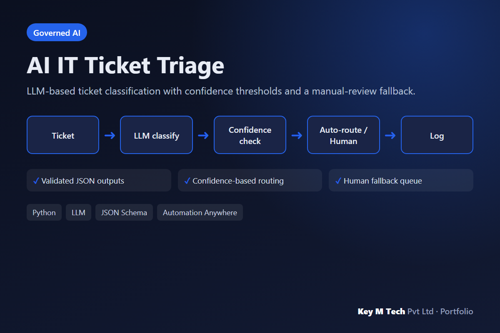

**Problem:** Ticket routing was manual and mis-routed tickets bounced between teams.

**What we built:** An LLM returns validated JSON (category, priority, team, confidence). High-confidence tickets route automatically; low-confidence ones go to a human queue. Every decision is logged.

- Validated JSON outputs
- Confidence-based routing
- Human fallback queue

**Stack:** Python, LLM, JSON Schema, Automation Anywhere

## Coding Agent VS Code Extension
*Developer Tools*

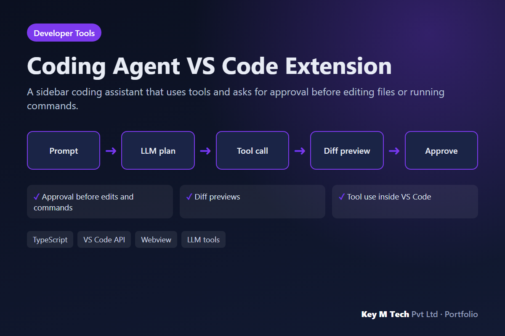

**Problem:** Developers wanted AI help inside the editor without giving it unchecked control.

**What we built:** A webview chat calls an LLM with file, search and terminal tools; every edit or command is shown as a diff or preview and needs a click to approve.

- Approval before edits and commands
- Diff previews
- Tool use inside VS Code

**Stack:** TypeScript, VS Code API, Webview, LLM tools

## Supply Chain Guardrail CLI
*Security Tooling*

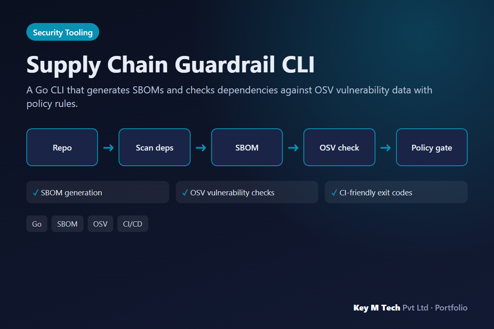

**Problem:** Teams shipped dependencies without knowing their vulnerability status.

**What we built:** Scans a project, produces an SBOM, queries OSV for known vulnerabilities, and fails CI when policy rules (severity, licence, age) are broken.

- SBOM generation
- OSV vulnerability checks
- CI-friendly exit codes

**Stack:** Go, SBOM, OSV, CI/CD

## Raspberry Pi + PiKVM + Tailscale Remote Ops
*Edge & Remote Access*

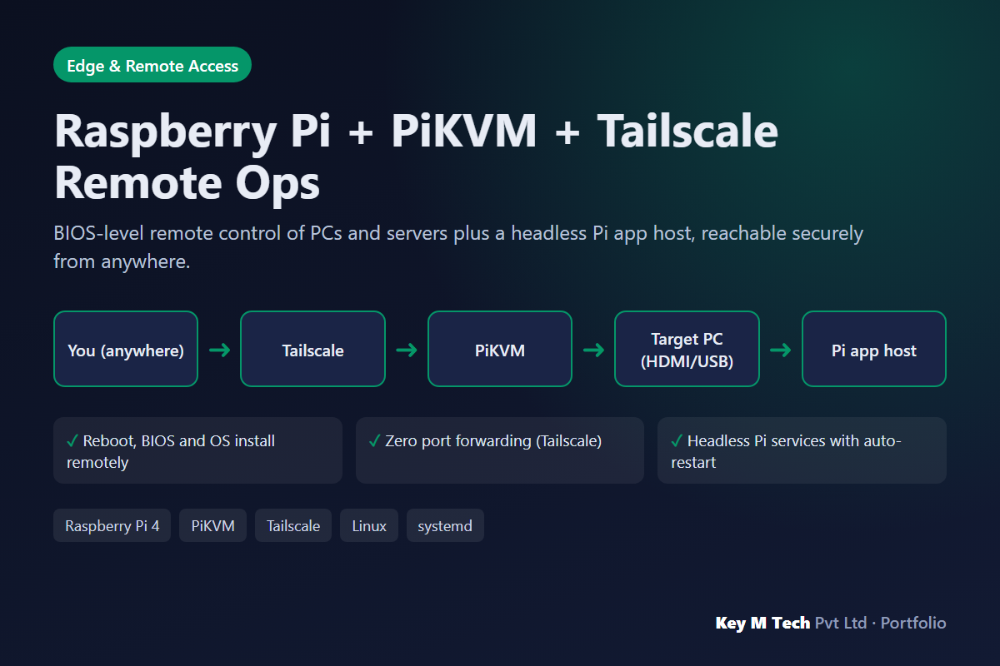

**Problem:** Remote machines that hang or need BIOS access normally require someone on site, and port forwarding is risky.

**What we built:** PiKVM on a Raspberry Pi 4 (HDMI capture + USB keyboard/mouse emulation) acts as a KVM-over-IP rescue console. A second Pi runs apps headless with systemd services and SSD boot. Both join a Tailscale tailnet, so there is no open port on the router.

- Reboot, BIOS and OS install remotely
- Zero port forwarding (Tailscale)
- Headless Pi services with auto-restart

**Stack:** Raspberry Pi 4, PiKVM, Tailscale, Linux, systemd

## News-aware Trading Automation Platform
*Python Automation*

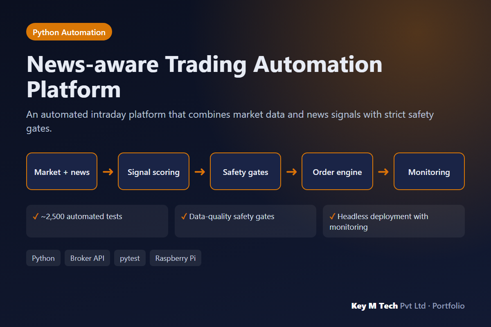

**Problem:** Automated strategies can trade on stale or unreliable data.

**What we built:** Pipelines ingest market data and news, score signals, and pass them through safety gates that halt trading when data is late or inconsistent. Runs headless on a Raspberry Pi with monitoring.

- ~2,500 automated tests
- Data-quality safety gates
- Headless deployment with monitoring

**Stack:** Python, Broker API, pytest, Raspberry Pi
